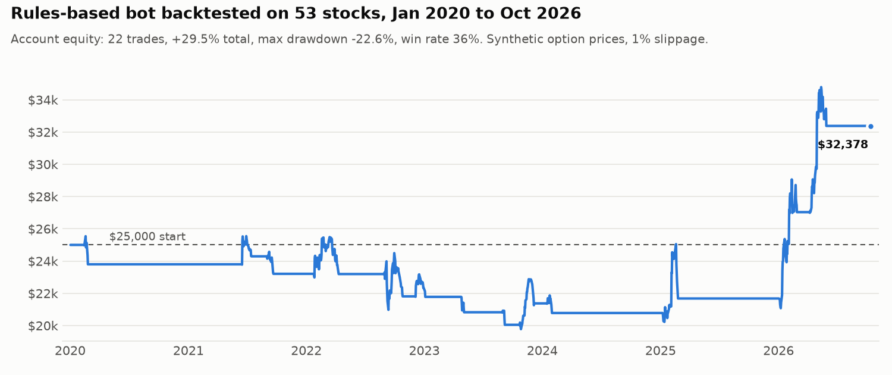
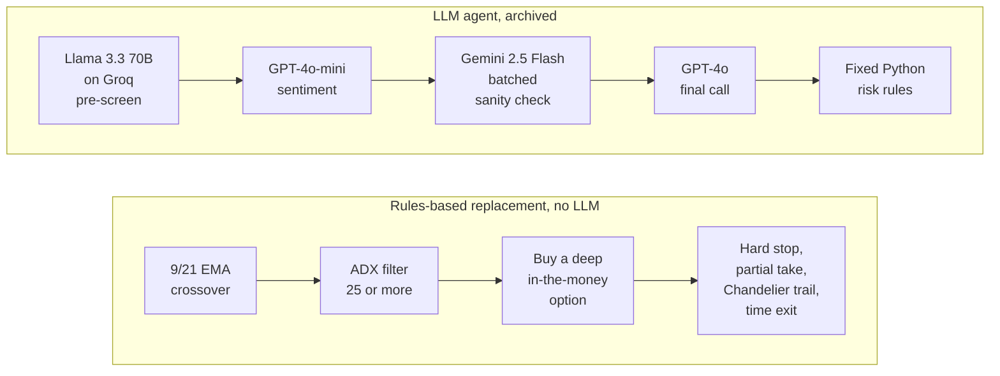

# AI Trading Agent

An options-trading agent I built, measured and retired, plus the backtesting platform I built so the next strategy gets tested before it trades. Paper trading only. No real money, and nothing here is financial advice.



*Output of `python backtest/run_backtest.py --universe` on data through Oct 13, 2026. Simulated trades on synthetic option prices, not live results.*

This repo is a sanitized snapshot of private work from May to July 2026, published as one commit in October 2026. Earlier versions of the agent and the bot sit in two private repositories with 19 commits. Secrets and account identifiers were removed before publishing.

## How it works

The archived agent passed each symbol through four models, and fixed Python risk rules had the last word. It lost money on paper, so I replaced it with plain rules that the backtester can replay day by day.



## What's in here

**`llm-agent-v2/`: the multi-LLM agent (May to June 2026, archived)**

Four models in a chain, each one a gate on the next:

1. **Llama 3.3 70B on Groq** pre-screens every symbol for free, so the later models only see the survivors.
2. **GPT-4o-mini** scores sentiment.
3. **Gemini 2.5 Flash** sanity-checks all remaining candidates in one batched call.
4. **GPT-4o** makes the final call and ranks the survivors head to head.

Fixed Python risk rules sit underneath, and no model can override them. A feedback loop checks whether GPT-4o's confidence actually predicts wins.

**`agent/`, `scheduler.py`, `api.py`: the replacement, with no LLM**

A rules-based bot that buys deep in-the-money options on a 9/21 EMA crossover, with an ADX filter.

**`backtest/`: the backtesting platform**

53 stocks, daily data from 2018 on (pulled free from yfinance), synthetic option pricing, and parameter sweeps with 3D plots. It reproduces the live bot's decisions.

**`scripts/test_*.py`: 104 tests** across the engine, option pricing, exit math and sweeps.

**`dashboard/`:** Next.js dashboard for the bot.

**`STRATEGY_EVIDENCE_LEDGER.md`:** every paper-trading run, losses included.

## Why the LLM agent was retired

It traded on its own on a paper account three times and lost money every time: 3 wins and 6 losses in run 1, 0 for 4 in run 2, and a 21% win rate in run 3. So I archived it, replaced it with plain rules, and built the backtester to test strategies before trusting them.

## Run it

```
pip install -r requirements.txt
python -m backtest.data.fetch            # daily bars, 2018 to today, from yfinance
python scripts/test_engine.py            # each test file prints "N passed, 0 failed"
python backtest/run_backtest.py --universe
```

The bot and the archived agent need API keys. Copy `.env.example` to `.env` and fill it in.

Built with Claude Code.
